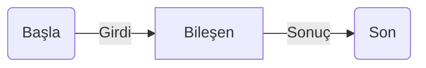
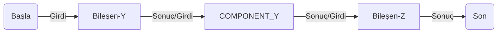

# Uruz Yazılım Ağacının Temelleri
***Yazılım büyüdükçe karmaşıklaşır.***
*Karmaşıklaştıkça anlaşılması, test edilmesi ve sürdürülebilmesi zorlaşır.*

***Bu yazı,***
*yazılımı daha küçük ve anlamlı parçalara ayırarak*
*yönetilebilir sistemler oluşturma üzerine*
*kişisel bir tasarım yaklaşımını anlatmaktadır.*

---

**Belge Sürümü:** V2.0
\
**Yazar:** [Uruz - Utku Ün (Kurt)](https://uruz-utku-un.github.io)
\
**Oluşturulma Tarihi:** 23.10.2026

---

## İçindekiler
- [Giriş](#giriş)
- [Genel İlke 1](#genel-i̇lke-1)
- [Genel İlke 2](#genel-i̇lke-2)
- [Genel İlke 3](#genel-i̇lke-3)
- [Tek Bileşenli Akış](#tek-bileşenli-akış)
- [Çoklu Bileşenli Akış](#çoklu-bileşenli-akış)
- [Tersine Bileşen Akışı](#tersine-bileşen-akışı)
- [Sonuç](#sonuç)

---

## Giriş
**Yazılım geliştirme sürecinde karşılaşılan problemlerin önemli bir kısmı**
**teknik yetersizliklerden değil,**
**zamanla kontrolsüz şekilde büyüyen karmaşıklıktan kaynaklanır.**

Birçok sistem başlangıçta basit bir amaca hizmet ederken
süreç içerisinde farklı ihtiyaçlar, eklenen özellikler
ve yanlış sorumluluk dağılımları nedeniyle
anlaşılması zor yapılara dönüşebilir.

**Uruz Yazılım Ağacı yaklaşımı,**
bu karmaşıklığı azaltmak amacıyla **üç temel prensip üzerine kurulmuştur:**
- **Her bileşen bir girdi almalı ve bir çıktı üretmelidir.**
- **Her bileşen yalnızca kendi amacına hizmet etmelidir.**
- **Her özellik gerçek bir ihtiyaca karşılık gelmelidir.**

Bu yaklaşımın amacı yalnızca daha temiz kod üretmek değil,
aynı zamanda daha anlaşılabilir, sürdürülebilir
ve ölçeklenebilir sistemler oluşturmaktır.

---

## Genel İlke 1
### Her Bileşen Bir Girdi Alır ve Bir Sonuç Üretir
Bir bileşenin temel görevi aldığı veriyi işlemek
ve anlamlı bir sonuca dönüştürmektir.

Bu yaklaşım sayesinde:
- Bileşenler birbirinden bağımsız kalır.
- Test süreçleri kolaylaşır.
- Hatalar izole edilebilir hale gelir.
- Aynı bileşen farklı projelerde tekrar kullanılabilir.

**Bir bileşenin çıktısı başka bir bileşenin girdisi olabilir.**
\
Böylece küçük yapı taşlarından daha büyük sistemler oluşturulabilir.

**Bu yaklaşımın temel amacı,**
sistemi birbirine sıkı sıkıya bağlı büyük yapılardan çıkarıp
anlaşılabilir parçalara ayırmaktır.

---

## Genel İlke 2
### Her Bileşen Tek Bir Amaca Hizmet Etmelidir
**Bir bileşen tasarlanırken öncelik her zaman temel işlev olmalıdır.**

Bir personel kayıt bileşeni düşünelim.
\
Görevi:
- Personel eklemek
- Personel bilgilerini doğrulamak

olabilir.

Ancak aynı bileşen;
- Rapor üretmeye,
- E-posta göndermeye,
- İstatistik oluşturmaya

başladığında sorumluluk sınırları bulanıklaşır.

Kısa vadede pratik görünen bu yaklaşım uzun vadede:
- Bakım maliyetini artırır,
- Hata ayıklamayı zorlaştırır,
- Sistemin anlaşılabilirliğini azaltır.

**Bu nedenle her bileşen mümkün olduğunca tek bir amaca odaklanmalıdır.**

---

## Genel İlke 3
### Özellikler Neden Var Oldukları İçin Var Olmalıdır
**Bir özelliğin geliştirilebiliyor olması,**
**geliştirilmesi gerektiği anlamına gelmez.**

Modern yazılım projelerinde birçok ürün zamanla işlevlerinden çok
özellik sayısıyla övünür hale gelmektedir.
\
**Ancak fazla özellik çoğu zaman fazla değer anlamına gelmez.**

Gereksiz özellikler:
- Öğrenme sürecini uzatır.
- Kullanıcı deneyimini karmaşıklaştırır.
- Bakım yükünü artırır.
- Hata ihtimalini yükseltir.

Bu nedenle yeni bir özellik eklenmeden önce şu soru sorulmalıdır:
> **Bu özellik gerçek bir problemi çözüyor mu?**

Eğer cevap hayır ise, eklenmemesi daha doğru olabilir.

---

## Tek Bileşenli Akış
**En temel senaryoda bir bileşen**
**yalnızca girdisini işler ve bir sonuç üretir.**

Bu yapı:
- Basitliği korur.
- Test süreçlerini kolaylaştırır.
- Hata izolasyonu sağlar.

---

## Çoklu Bileşenli Akış
**Gerçek projelerde tek bir bileşen yeterli değildir.**
\
Bu durumda bileşenler bir zincir halinde çalışabilir.

Her bileşen yalnızca kendi görevinden sorumludur.
\
Bu yapı:
- Modülerliği artırır.
- Ölçeklenebilirliği kolaylaştırır.
- Yeniden kullanılabilirliği destekler.

---

## Tersine Bileşen Akışı
**Bazı senaryolarda yalnızca sonuca ulaşmak yeterli değildir.**
\
Çıktıdan tekrar girdiye ulaşabilmek de gerekebilir.
\
Bu yaklaşım özellikle:
- Şifreleme sistemlerinde,
- Veri dönüşümlerinde,
- Doğrulama mekanizmalarında,
- Tersine mühendislik süreçlerinde

değerli hale gelir.
\
Ancak her bileşene zorunlu olarak uygulanmamalıdır.
\
**Tersine dönüş yalnızca gerçekten ihtiyaç duyulan durumlarda**
**tasarımın bir parçası olmalıdır.**

---

## Sonuç
Uruz Yazılım Ağacı yaklaşımı,
**yazılımı büyük ve karmaşık yapılar yerine**
**küçük, anlaşılabilir ve birbirleriyle tanımlı ilişkiler kuran bileşenler**
olarak ele alır.

Bu yaklaşım yeni bir teknoloji, programlama dili veya mimari kalıbı önermez.
\
Önerdiği şey daha temeldir:
- > **Her bileşenin bir amacı olsun.**
- > **Her amacın bir sınırı olsun.**
- > **Her sınır sistemi daha anlaşılır hale getirsin.**

**Yazılım geliştirme sürecinde sürdürülebilirliğin,**
**çoğu zaman yeni şeyler eklemekten değil;**
**gereksiz olanı eklememekten geçtiğine inanıyorum.**

---

***Uruz · Utku Ün · Kurt - The Wolf's Path***

---
