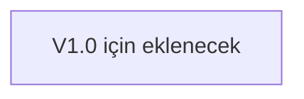

# Uruz · Web CSS Öğe Yapılandırma Standardı (U-WCSS-01)

**CSS kodları büyüdükçe karmaşıklaşır.**
\
Karmaşıklaştıkça okunması, anlaşılması ve düzenlenmesi zorlaşır.

**Bu belge,**
\
Uruz web projesinde kullanılan CSS kurallarının belirli bir yapı ve
mantık doğrultusunda düzenlenmesini amaçlamaktadır.
\
**CSS özelliklerini anlamlı kategorilere ayırarak,**
\
tutarlı, okunabilir ve sürdürülebilir bir kod yapısı oluşturmak üzerine
geliştirilmiş kişisel bir yazılım standardıdır.

---

**Belge Kodu:**
U-WCSS-01
\
**Kategori:**
Yazılım Standartları
\
**Kapsam:**
Web Geliştirme · CSS

**Belge Sürümü:**
V1.0
\
**Yazar:**
Uruz - Utku Ün (Kurt)
\
**Oluşturulma Tarihi:**
01.11.2026

---

## Bölümler

- [01 · Amaç ve Yaklaşım](#01--amaç-ve-yaklaşım)
    - [Temel Yaklaşım](#temel-yaklaşım)
    - [Temel Yaklaşım Şeması](#temel-yaklaşım-şeması)
- [02 · Öznitelik Sıralaması](#02--öznitelik-sıralaması)
- [03 · Kategori Açıklamaları](#03--kategori-açıklamaları)
    - [01. Çerçeve · Frame](#01-çerçeve--frame)
    - [02. Arka Plan · Background](#02-arka-plan--background)
    - [03. Boyutlandırma · Sizing](#03-boyutlandırma--sizing)
    - [04. Dış Boşluklar · Margin](#04-dış-boşluklar--margin)
    - [05. İç Boşluklar · Padding](#05-i̇ç-boşluklar--padding)
    - [06. Yerleşim · Layout](#06-yerleşim--layout)
    - [07. Hizalama · Alignment](#07-hizalama--alignment)
    - [08. Aralıklar · Spacing](#08-aralıklar--spacing)
    - [09. Metin Görünümü · Typography](#09-metin-görünümü--typography)
    - [10. Metin Boyutlandırma · Font Sizing](#10-metin-boyutlandırma--font-sizing)
    - [11. Metin Aralıkları · Text Spacing](#11-metin-aralıkları--text-spacing)
    - [12. Görsel Efektler · Visual Effects](#12-görsel-efektler--visual-effects)
- [04 · Uygulama Standardı](#04--uygulama-standardı)
    - [Örnek Kullanım](#örnek-kullanım)
- [05 · Sonuç](#05--sonuç)

---

## 01 · Amaç ve Yaklaşım

Bu belge, Uruz web sitesi içerisinde kullanılan CSS kurallarının
hangi sırayla düzenleneceğini tanımlar.

Belirlenen sıralama; kodun okunabilirliğini artırmayı, bileşenlerin
görsel ve yapısal özelliklerini birbirinden ayırmayı ve proje genelinde
ortak bir kod yazım standardı oluşturmayı amaçlar.

CSS özellikleri, bir öğenin dış görünümünden başlayarak iç yerleşimine
ve metinsel özelliklerine, oradan da görsel efektlerine doğru sıralanır.

### Temel Yaklaşım

> **Çerçeve → Arka Plan → Boyut → Boşluk**
> **→ Yerleşim → Hizalama → Aralık**
> **→ Tipografi → Efekt**

### Temel Yaklaşım Şeması



Bu düzen, CSS dilinin zorunlu kıldığı bir kural değildir.
Uruz projesinde kod tutarlılığı ve okunabilirliği sağlamak amacıyla
benimsenen bir geliştirme standardıdır.

---

## 02 · Öznitelik Sıralaması

CSS bildirimleri aşağıdaki kategoriler esas alınarak sıralanır.

| Sıra | Kategori | CSS Özellikleri |
|:---:|---|---|
| 01 | [Çerçeve](#01-çerçeve--frame) | `border`, `border-radius`, `outline` |
| 02 | [Arka Plan](#02-arka-plan--background) | `background`, `background-color` |
| 03 | [Boyutlandırma](#03-boyutlandırma--sizing) | `width`, `height`, `min-width`, `max-width` |
| 04 | [Dış Boşluklar](#04-dış-boşluklar--margin) | `margin` |
| 05 | [İç Boşluklar](#05-i̇ç-boşluklar--padding) | `padding` |
| 06 | [Yerleşim](#05-i̇ç-boşluklar--padding) | `display`, `position`, `grid-*`, `flex-*` |
| 07 | [Hizalama](#07-hizalama--alignment) | `align-items`, `justify-content`, `text-align` |
| 08 | [Aralıklar](#08-aralıklar--spacing) | `gap`, `row-gap`, `column-gap` |
| 09 | [Metin Görünümü](#09-metin-görünümü--typography) | `font-family`, `color`, `font-weight` |
| 10 | [Metin Boyutlandırma](#10-metin-boyutlandırma--font-sizing) | `font-size` |
| 11 | [Metin Aralıkları](#11-metin-aralıkları--text-spacing) | `line-height`, `letter-spacing` |
| 12 | [Görsel Efektler](#12-görsel-efektler--visual-effects) | `box-shadow`, `opacity`, `filter` |

---

## 03 · Kategori Açıklamaları

### 01. Çerçeve · Frame

Öğenin sınırlarını ve kenar görünümünü belirleyen özellikleri kapsar.

- `border`: Kenarlık özelliklerini tanımlar.
- `border-radius`: Kenarların yuvarlaklığını belirler.
- `outline`: Öğenin dış çizgisini tanımlar.

### 02. Arka Plan · Background

Öğenin arka plan görünümünü belirleyen özellikleri kapsar.

- `background`: Arka plan özelliklerini birlikte tanımlar.
- `background-color`: Arka plan rengini belirler.

### 03. Boyutlandırma · Sizing

Öğenin genişlik ve yükseklik değerlerini, ayrıca minimum ve maksimum
boyut sınırlarını belirler.

- `width`, `height`
- `min-width`, `max-width`

### 04. Dış Boşluklar · Margin

Öğenin çevresindeki diğer öğelerle arasındaki dış boşluğu belirler.

- `margin`

### 05. İç Boşluklar · Padding

Öğenin sınırları ile kendi içeriği arasındaki iç boşluğu belirler.

- `padding`

### 06. Yerleşim · Layout

Öğenin sayfa içerisindeki yerleşim modelini ve konumlandırma davranışını
belirler.

- `display`: Öğenin yerleşim modelini belirler. Örneğin `block`, `flex`
    ve `grid`.
- `position`: Öğenin konumlandırma yöntemini belirler.
- `grid-*`: Grid yerleşim sistemine ait özellikleri kapsar.
- `flex-*`: Flex yerleşim sistemine ait özellikleri kapsar.

### 07. Hizalama · Alignment

Öğenin veya içeriklerinin yatay ve dikey hizalanmasını belirler.

- `align-items`
- `justify-content`
- `text-align`

### 08. Aralıklar · Spacing

Yerleşim sistemindeki öğeler arasındaki boşlukları belirler.

- `gap`: Satır ve sütun aralıklarını birlikte belirler.
- `row-gap`: Satırlar arasındaki boşluğu belirler.
- `column-gap`: Sütunlar arasındaki boşluğu belirler.

### 09. Metin Görünümü · Typography

Metnin yazı tipini, rengini ve kalınlığını belirler.

- `font-family`
- `color`
- `font-weight`

### 10. Metin Boyutlandırma · Font Sizing

Metnin karakter boyutunu belirler.

- `font-size`

### 11. Metin Aralıkları · Text Spacing

Metin satırlarının yüksekliğini ve karakterler arasındaki mesafeyi belirler.

- `line-height`
- `letter-spacing`

### 12. Görsel Efektler · Visual Effects

Öğenin görsel sunumunu tamamlayan efektleri kapsar.

- `box-shadow`
- `opacity`
- `filter`

---

## 04 · Uygulama Standardı

Bu sıralama, Uruz projesindeki CSS bileşenleri ve stil kuralları yazılırken
esas alınır.

Uygulamada aşağıdaki ilkeler gözetilir:

1. CSS özellikleri belirlenen kategori sırasına göre yazılır.
2. Bir bileşende kullanılmayan kategoriler için boş başlık veya açıklama
   oluşturulmaz.
3. Aynı kategoriye ait özellikler mümkün olduğunca birlikte tutulur.
4. Kod yorumları, her özelliğin ne yaptığını tekrar etmek yerine gerekli
   durumlarda kullanım amacını ve tasarım kararını açıklar.
5. Bir özellik birden fazla kategoriyi ilgilendiriyorsa, kodun okunabilirliğini
   en iyi sağlayan konum tercih edilir.
6. Bir bileşene ait stiller, mümkün olduğunca kendi bileşen seçicisi altında
   sınırlandırılır.

### Örnek Kullanım

```css
/* ============================================================================
    İKİNCİL AFİŞ KARTI · SECONDARY BANNER CARD
============================================================================ */

.banner-card-secondary {

    /* BOYUTLANDIRMA */
    width: 100%;

    /* İÇ BOŞLUKLAR */
    padding: clamp(20px, 4vw, 36px);

    /* YERLEŞİM */
    display: grid;
    grid-template-columns: minmax(0, 1fr) minmax(0, 0.8fr);

    /* HİZALAMA */
    align-items: center;

    /* ARALIKLAR */
    column-gap: clamp(24px, 5vw, 64px);
}
```

---

## 05 · Sonuç

**Uruz CSS Öğe Öznitelik Düzeni,**
\
projede kullanılan stil kurallarının ortak bir mantıkla organize edilmesini
sağlayan bir kod yazım standardıdır.

**Amaç,**
\
her CSS dosyasını aynı görünüşte yazmak değil;
farklı bileşenlerde dahi aynı düşünce ve sıralama düzenini korumaktır.

**Tutarlılık, okunabilirlik ve sürdürülebilirlik bu standardın**
**temel ilkeleridir.**
